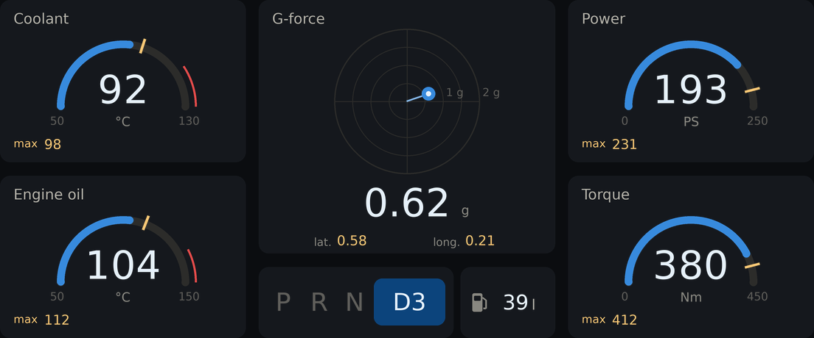
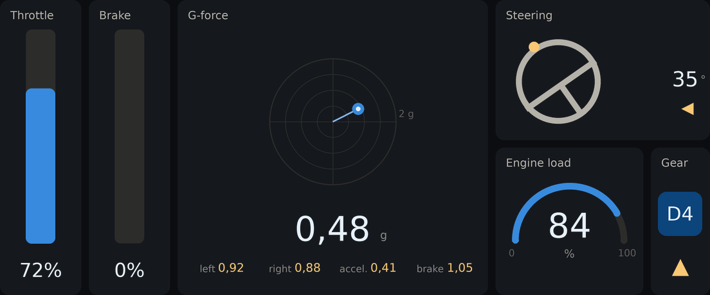
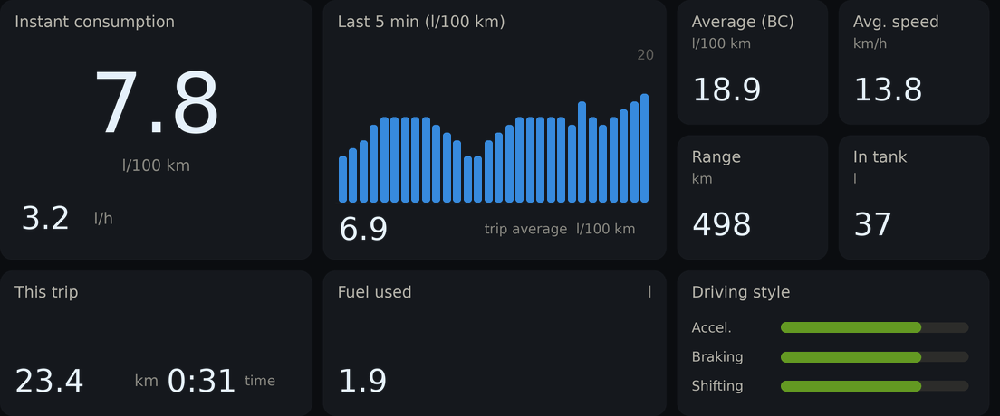
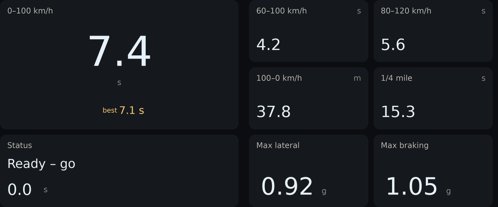
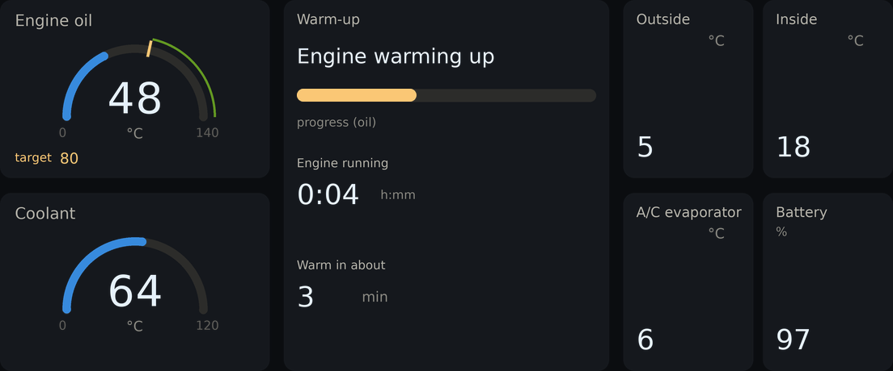

# IDRIVE GAUGE APP – iDrive-7-style gauge screens

A native iDrive app for **NBT Evo** (ID5/ID6, QNX) and **EntryNav2** (EntryEVO, Linux). Five screens; the main one,
**Engine**, is laid out 2-1-2:

- left: **coolant** and **oil temperature**,
- centre: **g-meter** (dot on a 2 g dial, total / lateral / longitudinal g) and **gear** (P R N D, with the current
  gearbox gear at D: D1, D2…),
- right: **power** (PS, "KM" in Polish) and **torque** (Nm).

Coolant, oil, power and torque show the **maximum of the current drive** (amber marker on the arc and a "max" number).
The maxima start from nothing every time the app starts; those of the last drive stay in `max.txt`. The power and
torque scales grow with the maximum. Next to the gears is the **fuel** in the tank (`sensors.fuel`, `tanklevel`).

**About 60 images per HMI state** (car-verified: images beyond about 60 stay empty). So only the big values are built
from digits (3 cells each); every other number (maxima, scale ends, fuel, g) is one picture of the whole number. The
Engine screen has 47 images.



The previews are rendered by `make_db.py` (`res/preview*.png`: English `*_en.png`, Polish without a suffix, the
other gauge colours `preview_red/orange/green.png`).

**Language** follows the iDrive language. Menu and settings texts are in the text DB (`pl.txt` in Polish, every other
language in English), which iDrive picks itself. Texts drawn on the screens (card titles, "lat./long.", "PS") are in
the pictures, so the app picks them by `vehicle.language` from CDS: 18 = Polish, anything else = English. Until the
language arrives, the screen is Polish. Decimal numbers always use a **comma** (separate decimal-point sets took about
2.4 MB). Adding a language: [Translations](#translations).

**Settings** (OPTION on any screen → Settings; saved in `<data dir>/settings.txt`): gauge colour (blue, red, BMW
orange, green), temperature (°C / °F), power (PS / kW / hp), torque (Nm / lb-ft), fuel (litres / US gallons). Values
and maxima are kept in base units; only what is shown is converted. Frames in the gauge colour (arcs, g-meter dot, lit
gear) have one pack per colour (`GaugeApp_frames_c0..3.bin`); the app loads only the chosen one.

The app appears as a **GAUGE APP** row in the **ConnectedDrive** menu (`applicationType="OnlineServices"`,
car-verified on EntryNav2; `"Online"` alone does not work). `python3 make_db.py --menu media` moves it to Media/Radio
(`applicationType="Custom"`, after the Bluetooth audio row, where NbtAad and entry-aad put "Android Auto"). Its ids
differ from theirs, so the apps can be installed side by side.

**Gears:** in D the car sends the gearbox gear + 4 in `driving.gear` (car-verified on an EntryNav2 F40: 5 = D1); 4 is
plain "D".

**What we know about the EntryNav2 head unit** (system, app framework, the full CDS list with formats and scan
results): [docs/EntryNav2](docs/EntryNav2/README.md).

### More screens (OPTION)

Screens are chosen on the Settings page, like the gauge colour: OPTION on any screen → Settings; the screens (Engine,
Driving, Fuel and trip, Performance, Warm-up) are at the top of the list, the settings below the line. The OPTION menu
has only one entry of the app, "Settings"; the entries above it (e.g. "Wyłącz pojazd" – switch the car off) come from
iDrive. The app remembers the screen shown last (`screen=` in `settings.txt`, also over a restart): the GAUGE APP row
opens it (the entry button is a `raAction`, the app fires `focusEvent` 90 + screen, the way entry-aad opens its menu).
Each screen is its own HMI state with its own ~60-image budget:

| Screen | What it shows | CDS data |
|---|---|---|
| **Engine** (state 10) | as above | |
| **Driving** (state 14) | throttle and brake (bars), g-meter with maxima in 4 directions, steering wheel and angle, engine load %, gear, shift hint | `acceleratorPedal`, `brakeContact`, `steeringWheel`, `acceleration`, `torque` + `RPMSpeed`, `gear`, `shiftIndicator` |
| **Fuel and trip** (state 15) | instant consumption (l/100 km and l/h), last 5 minutes chart, trip average, trip computer averages, range, tank, km and time since start, fuel used, driving style | `engine.consumption`, `speedActual`, `averageConsumption`, `averageSpeed`, `sensors.fuel`, `drivingStyle` |
| **Performance** (state 16) | 0–100 (last and best), 60–100, 80–120, 100–0 (m), 1/4 mile, status, max lateral and braking g | `speedActual`, `acceleration` |
| **Warm-up** (state 17) | oil and coolant arcs from 0 °C (oil with an 80 °C target and a green zone), status, progress bar, engine running time, estimated time to warm, outside / inside / A/C evaporator temperature, battery % | `engine.temperature`, `engine.status`, `RPMSpeed`, `temperatureExterior`, `temperatureInterior`, `ACSystemTemperatures`, `sensors.battery` |

| Driving | Fuel and trip |
|---|---|
|  |  |
| **Performance** | **Warm-up** |
|  |  |

- **Engine load** = torque / the largest torque seen at that rpm. The curve is learned while driving and kept in
  `<data dir>/torque-env.txt`. Until there are at least 60 Nm at that rpm the card shows "--". It stands in for a boost
  gauge: CDS has no boost pressure.
- **Instant consumption** comes from the `engine.consumption` counter, which only grows and wraps at 65536. Its unit
  is undocumented; 1 µl per step is assumed at first. The app finds the real factor itself from the fuel used from the
  tank: after every 8 l without refuelling, saved in `<data dir>/fuel-cal.txt`, "fuel counter calibrated" in the log.
  Until the first calibration, instant consumption and fuel used may differ from the trip computer.
- **Performance** uses `driving.speedActual`, i.e. whole km/h. The moments a threshold is crossed are interpolated
  between readings. 0–100 and 1/4 mile start from the last reading at a standstill ("Ready – go"); 60–100 and 80–120
  are timed by themselves on every acceleration. The accuracy depends on how often the car sends the speed.
- **Only the screen on display is written:** the app reads the title of the state on screen (`hmi.graphicalContext`,
  `menuTitle`, `appType`) and sends pictures only to that screen. With something else on screen (radio, a menu, the
  settings) it sends nothing. It writes every screen only while the title has not arrived yet, or when a plugin state
  (`appType` "4") with an unknown title is shown. In the log: `on screen: '…'` lines.
- **The frame packs are mapped (`mmap`), not read into memory.** The system loads only the pages of frames that are
  sent and can drop them under memory pressure. The pack of screens 1–4 (`GaugeApp_frames_s.bin`) is mapped the first
  time one of them is drawn; someone who only uses the Engine screen never opens it.
- **Oil 0 °C in the first reading after a start** (`{"engine":68,"oil":0}`, sensor not read yet) counts as no data
  when the coolant is above 30 °C.
- **Warm-up:** the engine runs when `engine.status` = 2 (or rpm > 400 if the car sends no status). The engine is warm
  when the oil reaches 80 °C (`kWarmOilTarget`, the usual rule for BMW engines). The progress bar counts from the oil
  temperature at the start. The time to warm is estimated from how fast the oil warmed in the last 1–5 minutes, so it
  shows "--" during the first minute. Temperatures follow the °C / °F setting.
- The new screens show fuel in litres whatever the fuel unit setting is.
- Every frame is stored as an indexed PNG (32 colours for texts and numbers, 256 for the rest), 4–6 times smaller
  than RGBA; car-verified. The 1280x480 package is about 12 MB: `GaugeApp_frames.bin` about 1.4 MB, each colour pack
  about 1 MB, `GaugeApp_frames_s.bin` about 6 MB.

## How it works

At start HmiMain3D loads `Plugins/GaugeApp/GaugeApp.manifest` (the `PluginApp` framework, the same as BMW's
SecurityMenu / ActiveSeating, NbtAad and entry-aad). iDrive does not let an app draw, so every screen is made of
pictures:

- `GaugeApp.xml` describes, per screen, a background picture (cards, labels, scales, the dial) and the pictures on top
  of it. Each has a pixel position and a `raImageModel`, a picture the app sends as PNG data.
- The frame packs `GaugeApp_frames*.bin` hold every frame: arcs (61 steps), max markers, digits in two sizes, the
  g-meter dot (21×21 grid, 0.2 g steps), gear cells, the pictures of screens 1–4. The iDrive image DB
  (`GaugeApp_ALL_Images.zip`) holds only the menu row icon.
- `libGaugeApp.so`:
  1. maps the frame packs at start;
  2. after about 1.5 s subscribes to 22 **CDS** (Car Data Service) properties with the call NbtAad and entry-aad use
     to read `driving.gear`;
  3. every 200 ms picks the frame of every picture of the screen on display (`src/gauge_view.hpp`,
     `src/screens_view.hpp`) and sends **only the ones that changed** with `PluginApp::updateModel(model, bmw::Image)`;
  4. a value that is unavailable, wrong or implausible (e.g. `{"error":400}`) shows `--`.

Why not through the iDrive image DB – diagnostics on an EntryNav2 (F40) showed that:
- with 635 frames in the DB, iDrive shows **no** picture at all (and reports `onError 9`); with a few, all of them;
- pictures sent by the app as data work, keep their x/y position, stack, and can be replaced about 5 times a second;
- the visible area of an app state is about 1250 × 470 px at 1280x480. The 960×400 design is scaled ×1.15 to
  1104×460 and centred ([Screen resolutions](#screen-resolutions)).

| CDS property | Example value | On screen |
|---|---|---|
| `engine.temperature` | `{"temperature":{"engine":19,"oil":18}}` | coolant (50–130 °C), oil (50–150 °C) |
| `engine.torque` | `{"torque":380}` (Nm) | torque |
| `engine.RPMSpeed` | `{"RPMSpeed":3600}` | power only: PS = Nm × rpm / 7023.5 |
| `driving.acceleration` | `{"acceleration":{"lateral":-0.19,"longitudinal":65535.00}}` | g-meter (m/s² ÷ 9.81) |
| `driving.speedActual` | `{"speedActual":87}` | longitudinal g when the car sends no `longitudinal` |
| `driving.gear` | `{"gear":6}` | gear (1 N, 2 R, 3 P, 4+ D1…) |

The full list with formats and scan results: [docs/EntryNav2/CDS.md](docs/EntryNav2/CDS.md); a community list:
<https://bimmergestalt.github.io/BMWConnectedAnalysis/cds/> (some units marked "probably" there). CDS has no engine
power, so it is computed from torque and rpm.

**Maxima** are reset at every start of the app. Those of the last drive are in `<data dir>/max.txt` (NBT Evo:
`/var/opt/gaugeapp`, EntryNav2: `/var/local/data/GaugeApp`), e.g. `coolant=98.0`, written at most every 30 s and when
the app closes, through a temporary file and a rename. A new maximum must come in **two readings in a row** (the
smaller one counts), so a single wrong reading never becomes a record.

**Power and torque scales:** from 0 to the maximum + 5 %, rounded up to 50. The smallest scale end is 150 PS and
250 Nm. The scale only grows.

## Verified / not verified

**Verified on the PC:**
- The logic: parsing, power, g from the speed, maxima with the single-reading guard, `max.txt`, the frame of every
  picture of every screen (`tests/test_cds_values.cpp`).
- The whole app lifecycle against a framework mock, for both targets: `pluginAppInfo`, `onInit`, the subscriptions,
  sending only changed pictures, bad data, the settings and entry buttons, saving in `onFinalize` and reading at the
  next `onInit` (`tests/app_host_test.cpp`). `make check`.
- Every `bmw::…` function the library imports is exported by the libraries of **both** cars (`tests/check_abi.sh`,
  `nm -D` on `lib/`). The layout of `bmw::Image` (28 bytes: a file name and a buffer) is read from the machine code of
  `libCoreFramework`.
- The EntryNav2 build compiles for ARM (hard-float, NEON), needs only `GLIBC_2.4` and exports only `pluginAppInfo`.

**Verified in a car (EntryNav2, F40, 1280x480):** loading, the menu row, states and moving between them, labels,
pictures sent as data with positions and stacking, about 5 frames/s, all five screens, the settings page, indexed
PNGs, CDS data (`engine.temperature`, `engine.RPMSpeed`, `engine.torque`, `driving.gear`, `driving.acceleration`
with the longitudinal axis – 65535 only in the first reading – and `driving.speedActual`), saving the maxima.

**Not verified – to confirm in a car:**
- **The NBT Evo version:** the `qcc` build (no QNX SDP 6.5 here) and whether `bmw::Image` is laid out as on EntryNav2.
- **800x480 and 1440x540** (the size of the state area is estimated, see below).
- The scale of the throttle and brake values, the sign of the steering angle (`kSteerSign`), the unit of
  `engine.consumption` (calibrated from the tank level), the acceleration signs (`kLatSign`, `kLonSign` in
  `src/cds_values.hpp`). Raw values go to the log.

> Changing the head unit is at your own risk. The app patches nothing and writes only into its own data folder.

## Requirements

- **NBT Evo:** root / SSH access and one of the codings **A4A, A4A_REMOTE_APPS, REMOTE_HMI, TOUCH_COMMAND** (without
  it HmiMain3D does not load PluginApps), as for NbtAad.
- **EntryNav2:** root access over SSH (ENET cable), as for entry-aad.

## Screen resolutions

The same look (the 960×400 design) is scaled to every resolution the units run at (`gaugegen/layout.py`,
`SCREEN_PRESETS`; panel modes: [docs/EntryNav2/System.md](docs/EntryNav2/System.md)):

| Resolution | Screen | Scale | Picture | Position | In a car |
|---|---|---|---|---|---|
| 800x480 | 6.5" (EntryNav2 only) | 0.80 | 768×320 | 1, 75 | not verified (smaller text) |
| 1280x480 | 8.8" (e.g. F40) | 1.15 | 1104×460 | 73, 4 | **verified** (EntryNav2) |
| 1440x540 | 10.25" | 1.30 | 1248×520 | 81, 5 | not verified |

The plugin state area at 800x480 and 1440x540 is estimated (as at 1280x480: about 30×10 px less than the panel). If
the picture is shifted or cut in the car, fix the scale or position in `SCREEN_PRESETS` (or once with `--scale`,
`--x`, `--y`). The library and the image ids are the same for every resolution; only the XML, the frame packs and the
zips differ. 1280x480 is in the repository (`plugin/`); `python3 make_db.py --all` (or `make gen`) writes the others to
`gen/<resolution>/`. The HMI also knows 1280x720 and 1920x720, but no unit drives them, so there are no packages for
them. NBT Evo has no 6.5" screens, so it gets no 800x480 package.

On an EntryNav2, `cat /sys/class/drm/card0-*/modes` (over SSH) shows the resolution.

## Build

The generated files (`plugin/`: `GaugeApp.xml`, the frame packs, both zips; `src/gauge_ids.hpp`, `res/preview*.png`)
are in the repository, so building needs no Pillow. After changing the look:

```
python3 make_db.py              # Pillow + DejaVu Sans (--font file.ttf; --x / --y move the screen)
python3 make_db.py --all        # every resolution: 1280x480 in plugin/, 800x480 and 1440x540 in gen/<resolution>
make gen                        # only 800x480 and 1440x540, and only when the generator changed
make check                      # host tests of both versions (plain g++)
```

### BMW libraries (`lib/`)

Building needs two files of the iDrive framework: `libAppFramework.A.so` and `libCoreFramework.A.so`. They are BMW's
files, so **they are not in the repository** (`lib/` is git-ignored). Copy them from a unit of the same type, best from
the car you build for (the same software version). They are only needed to link; only `libGaugeApp.so` goes to the
car.

| Unit | Path on the unit | Folder in the project | Sizes (F40 / NBT Evo ID5) |
|---|---|---|---|
| EntryNav2 | `/opt/hmi/lib/` | `lib\Entry_Evo_libs\` | about 40 KB / 72 KB |
| NBT Evo | `/opt/hmi/ID5/lib/` (on `hu-omap`) | `lib\NBT_evo_libs\` | about 52 KB / 95 KB |

**EntryNav2 over SSH** (the same link as for installing), in PowerShell, in the project folder:

```powershell
New-Item -ItemType Directory -Force lib\Entry_Evo_libs
scp root@169.254.1.0:/opt/hmi/lib/libAppFramework.A.so root@169.254.1.0:/opt/hmi/lib/libCoreFramework.A.so lib\Entry_Evo_libs\
```

Or with a USB stick, on the unit: `cp /opt/hmi/lib/libAppFramework.A.so /opt/hmi/lib/libCoreFramework.A.so
/media/<stick>/` and `sync`.

**NBT Evo** has no `scp`. With a USB stick, on the unit (log in as in
[docs/NbtEvo_Installation.md](docs/NbtEvo_Installation.md), then `on -f /net/hu-omap/ /bin/sh`):

```sh
cp /opt/hmi/ID5/lib/libAppFramework.A.so /opt/hmi/ID5/lib/libCoreFramework.A.so /fs/usb0/
```

Or over SSH from the computer (Git Bash / WSL, in the project folder; `root@CAR` and the SSH options as in the NBT
guide):

```sh
mkdir -p lib/NBT_evo_libs
for f in libAppFramework.A.so libCoreFramework.A.so; do
  ssh root@CAR "cat /net/hu-omap/opt/hmi/ID5/lib/$f" > lib/NBT_evo_libs/$f
done
```

Check: both files are about the size in the table (not 0 bytes). `make` and `build_entryNav2.bat` stop with a message
when they are missing. Files from another software version usually work too (the same exported `bmw::PluginApp`
functions), but the library is verified only with the files from an F40 (EntryNav2).

### NBT Evo

QNX SDP 6.5.0 (`qcc`; installed with QNX Momentics IDE 4.7) and the BMW libraries from `/opt/hmi/ID5/lib` in
`lib/NBT_evo_libs`.

- **Windows:** `build_nbt.bat` (or `build_nbt.bat D:\QNX650` if QNX is not in `C:\QNX650`). It calls
  `qnx650-env.bat`, compiles the library and puts the package folder (the app, `install.sh`, `uninstall.sh`,
  `FILES`) into `dist\NBT\<resolution>\GaugeApp`:
  1280x480, and 1440x540 when it is in `gen/` (`make gen` in WSL).
- **Linux / the qnx650-docker image:** `make` (`libGaugeApp.so`).
- **Momentics IDE** (if you prefer a project): *File → New → QNX C/C++ Project*, type *Shared Library*, variant
  **armle-v7** (so), C++ library **GNU libstdc++** (not Dinkum – like HmiMain3D); sources `src/*.cpp`
  (`engine_data`, `cds`, `render`, `frames`, `storage`, `log`), include path `src`, define `_QNX_SOURCE`, option
  `-fvisibility=hidden`, link `libAppFramework.A.so` and `libCoreFramework.A.so` from `lib/NBT_evo_libs` with the
  linker option `--allow-shlib-undefined`; output name `libGaugeApp.so`.

The code is C++98 (GCC 4.4.2 of SDP 6.5); on the PC it compiles with `g++ -std=gnu++98` without warnings, but `qcc`
has not been run here. Every BMW function it uses is in the libraries of `lib/NBT_evo_libs` (`nm -D`), and
`bmw::Image` has the same layout on NBT as on EntryNav2 (read from the machine code).

### EntryNav2

Copies of `libAppFramework.A.so` and `libCoreFramework.A.so` from `/opt/hmi/lib` in `lib/Entry_Evo_libs`, and the
Docker image of `toolchain/Dockerfile` (Ubuntu 12.04: armhf GCC 4.6 and eglibc 2.15, the car's version). A newer
compiler would link functions the car lacks (e.g. `clock_gettime@GLIBC_2.17`).

**Windows:** `build_entryNav2.bat` does everything: starts Docker Desktop if needed, builds the compiler image the
first time, draws the pictures of the other resolutions in WSL (`make gen`, only when the generator changed), builds
every package and checks that the library needs only `GLIBC_2.4`. `build_entryNav2.bat test` runs the tests in WSL
first (`make check`) and builds only when they pass.

By hand (Linux / WSL):

```
docker build -t gauge-entrynav2-tc toolchain        # once
make gen                                            # 800x480 and 1440x540 (Pillow, outside Docker)
bash toolchain/tc-entrynav2.sh make entrynav2-dist-all
```

Result: for `800x480`, `1280x480` and `1440x540`, `dist/EntryNav2/<resolution>/GaugeApp/` (the library – the same
in all of them, the manifest, the XML, both zips, the frame packs, `install.sh`, `uninstall.sh`, `FILES`) and the
same folder as `gauge-app-entrynav2.tar` (`toolchain/pack.sh`). One resolution: `make entrynav2-dist RES=1440x540`.

## Install

Step-by-step guides:

- **EntryNav2:** [docs/EntryEvo_Installation.md](docs/EntryEvo_Installation.md)
- **NBT Evo:** [docs/NbtEvo_Installation.md](docs/NbtEvo_Installation.md)

Both units get the same package folder `GaugeApp/` (the app, `install.sh`, `uninstall.sh`, `FILES`) and install it
the same way; only getting the folder to `/tmp/GaugeApp` on the unit differs:

| | NBT Evo | EntryNav2 |
|---|---|---|
| Package | `dist\NBT\<resolution>\GaugeApp` | `dist/EntryNav2/<resolution>/gauge-app-entrynav2.tar` (or the `GaugeApp` folder beside it) |
| To `/tmp/GaugeApp` | USB stick, then on `hu-omap` (`on -f /net/hu-omap/ /bin/sh`): `cp -R /fs/usb0/GaugeApp /tmp/`; or `ssh … cat` per file | `scp` the tar to `/tmp`, then on the unit: `cd /tmp && tar -xf gauge-app-entrynav2.tar` |
| Install | `cd /tmp/GaugeApp && sh install.sh` | `cd /tmp/GaugeApp && sh install.sh` |
| Restart | yourself, when everything is installed: hold the power button about 30 s | yourself, when everything is installed: `reboot` |

`install.sh` (`package/install.sh`, POSIX `sh`, QNX or Linux by `uname`) checks every file against `FILES`, on
EntryNav2 also every library the app needs, then makes the system partition writable, replaces the old version,
checks the copy and makes the partition read-only again. It **never restarts anything**, so several apps can be
installed in a row before one restart. `sh uninstall.sh [--purge]` removes the app (and with `--purge` its data).
The packaging and install rules are written up for other projects to follow:
[docs/Install_Standard.md](docs/Install_Standard.md).
A **GAUGE APP** row appears in **ConnectedDrive** after the restart.

### Both versions

| | NBT Evo | EntryNav2 |
|---|---|---|
| App folder | `/opt/hmi/ID5/data/ro/Plugins/GaugeApp` | `/opt/hmi/data/ro/Plugins/GaugeApp` |
| Data folder (maxima, settings, off switch) | `/var/opt/gaugeapp` | `/var/local/data/GaugeApp` |
| Log | `slog` (`sloginfo \| grep GaugeApp`) + USB stick | `gauge-app.log` in the data folder (512 KB) + USB stick |
| Restart-loop guard | none | 3 HMI restarts within 2 min of loading → the app turns itself off |

- **Switch off without uninstalling:** `touch <data dir>/app.disable` and restart.
- **After the guard tripped (EntryNav2):** check the log, then `rm -f /var/local/data/GaugeApp/app-guard` and restart.
- **Uninstall:** delete the app folder (and the data folder if you do not need the maxima and settings), restart.
- **Update:** like installing; the data folder stays.

## Diagnostics

**Log on a USB stick:** create an empty file `gauge-app.log` on a stick on the computer and plug it into the car – the
log is appended there (4 MB limit). NBT Evo looks for it in `/fs/usb*` and `/mnt/umass*`, EntryNav2 in every folder
under `/media`, `/mnt` and `/run/media`.

Every CDS property is logged raw for its first 5 readings, e.g.
`CDS driving.acceleration = '{"acceleration":{"lateral":-0.19,"longitudinal":65535.00}}' -> ok`. That shows what your
car really sends and whether the units match.

**No data (`--` everywhere):** 25 s after the start, `no CDS value arrived…` appears in the log. The car does not
publish these properties to apps, or the subscription failed – send that part of the log.

**The screen is scrambled** (pictures under each other, cut, shifted): iDrive treats picture positions differently.
Send a photo of the screen; the whole picture moves with `make_db.py --x/--y`, the layout is in `gaugegen/`.

**No row in the menu:** check the coding (NBT Evo), that every file is there, a clash of `entryButtonFocusID` / the
connector `id` in the manifest with another app, and the HMI log.

## Customising

- **Look, layout, colours, texts, coolant and oil ranges, the smallest scale ends:** constants in `gaugegen/`
  (colours: `base.py`, Engine screen layout: `layout.py`, screens 1–4: `screens.py`, texts: `texts.py`), then
  `python3 make_db.py` and rebuild.
- **Acceleration unit / sign, power factor:** the "tuning" constants in `src/cds_values.hpp`.
- **Refresh and maxima save rate:** `kRenderMs`, `kSaveEveryS` in `src/app.hpp`.

### Translations

Every text of the app is in one place: `TEXTS` in `gaugegen/texts.py`, one complete block per language (`"pl"`,
`"en"`). A new language (e.g. German) is two changes in that file:

1. **Text block:** copy the `"en"` block under the new code (`"de": {...}`) and translate the texts.
2. **Language definition:** add a line to `UI_LANG_DEFS`, e.g. `UiLangDef("de", (1,), ("de",))`:
   - `(1,)` are the CDS `vehicle.language` values that pick it (1 = DE, 2 = EN_UK, 3 = EN_US, …, 18 = PL);
   - `("de",)` are the text DB files (`LANGS` keys) that get its menu texts.

   Languages not listed in any line get `UI_LANG_FALLBACK` (English).

Then `python3 make_db.py --all` (with Pillow) and `make check`. Everything else is generated:
- pictures: backgrounds, status lines, the previews `res/preview*_de.png`;
- the text DB;
- in `src/gauge_ids.hpp`: the enum `UiLang` (`kLangDe`), the `vehicle.language → language` map, the screen titles,
  the Engine screen backgrounds and the power unit.

Nothing changes in C++.

`make_db.py` writes nothing when the new block lacks a key or a list has another length (e.g.
`TEXTS: [de].warm.BATT is missing`). It also stops when a menu text is not ASCII or the power unit (`power_unit`) is
not one of `UNITS`.

**Limits:**
- **Menus in ASCII only:** menu and settings texts (`settings`, `settings_title`, `screen_titles`) go into the iDrive
  text DB, which takes only **ASCII**. Write umlauts as "ae/oe/ue" and Cyrillic transliterated.
- **Pictures without limits:** texts drawn into pictures (`engine`, `screens`, `warm`, `*_status`) may use any letter
  DejaVu Sans has, umlauts and Cyrillic included.
- **Package size:** every language adds a few hundred KB (backgrounds and status lines).

## Project layout

```
make_db.py                 generator: plugin/GaugeApp.xml, src/gauge_ids.hpp, frame packs, both zips, res/preview*.png
gaugegen/                  the generator's modules (layout, texts, ids, drawing, XML, header, packs, previews)
src/cds_values.hpp         CDS parsing, power, g, maxima, language (pure logic, tested)
src/drive_stats.hpp        g per direction, engine load, fuel calibration, trip, performance (pure logic)
src/gauge_view.hpp         Engine screen: the frame of every picture, settings (pure logic, tested)
src/screens_view.hpp       screens 1..4 and their table kScreenDescs (pure logic, tested)
src/gauge_ids.hpp          generated: image ids, slots, screen titles, UI languages
src/compat.hpp             GA_STATIC_ASSERT, GA_COUNT (C++98)
src/bmw_framework.hpp      hand-written declarations of the BMW framework (symbol names as in the cars' libraries)
src/app.hpp                the modules' internal interface: constants, AppState, MutexLock, FrameSink
src/engine_data.cpp        the PluginApp: entry point, vtable, onInit/onFinalize, buttons, render tick
src/cds.cpp                CDS values -> app state (one stub per property)
src/render.cpp             which pictures changed -> only those are sent; what is on screen
src/frames.cpp             frame packs (mmap), pictures as data into raImageModels
src/storage.cpp            max.txt, settings.txt, learned files, crash guard
src/log.cpp                log (file, USB stick, slog), time
plugin/                    the plugin's files for 1280x480: GaugeApp.manifest (the manifest for CAppManager) and,
                           generated, GaugeApp.xml (menu row, screens), both zips, the frame packs
gen/<resolution>/          generated, git-ignored: the same for 800x480 and 1440x540 (make gen)
toolchain/                 the Docker image for the EntryNav2 build, pack.sh (the package folder and tar)
package/                   install.sh and uninstall.sh: the same for NBT Evo and EntryNav2, put into every package
tests/                     host tests, the framework mock (both versions), check_abi.sh (imports vs the cars' libraries)
lib/NBT_evo_libs, lib/Entry_Evo_libs   copies of BMW's libraries from the cars (not part of the project)
docs/                      install guides, Install_Standard.md (the shared install standard); docs/EntryNav2:
                           what we know about the EntryNav2 head unit
```

## License and origin

The ABI framework patterns (`PluginApp` constructor, own vtable, `Runnable`, `pluginAppInfo`) and the way CDS is read
come from NbtAad (<https://github.com/Sq00ky/Supra-iDrive6-Android-Auto>, PolyForm Noncommercial 1.0.0) and
entry-aad, so this project is published under the same license: non-commercial use only. BMW's libraries
(`libAppFramework`, `libCoreFramework`) are not part of this project.
