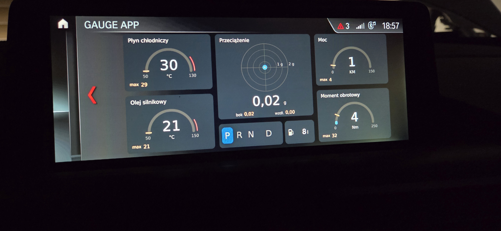
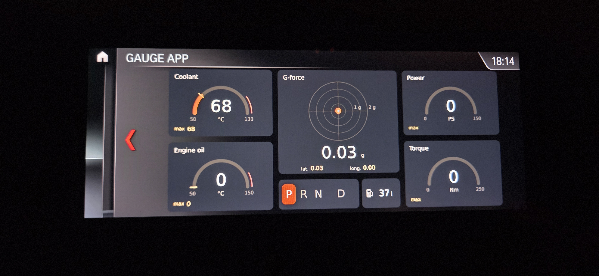

NBTEVO

EntryNav2

[Polish version of readme](README_PL.md) – the Polish README is the complete one (installation commands included).

# IDRIVE GAUGE APP – an iDrive-7-style engine screen

A native iDrive app for **NBT Evo** (ID5/ID6, QNX) and **EntryNav2** (EntryEVO, Linux). One screen, laid out 2-1-2:

- left: **coolant** and **oil temperature**,
- centre: **g-meter** (dot on a 2 g dial, total / lateral / longitudinal g) and **gear** (P R N D, with the current
  gearbox gear at D: D1, D2…),
- right: **power** (PS / KM) and **torque** (Nm).

Coolant, oil, power and torque show an **all-time maximum** (amber marker on the arc and a "max" number). The maxima
are kept in a file and never reset by the app; the power / torque scale grows with them. Sample rendering:
[`res/preview.png`](res/preview.png).

The app appears as a **GAUGE APP** row in Media/Radio, after the Bluetooth audio row – the place NbtAad and entry-aad
use for "Android Auto" (car-verified there). Its IDs differ from theirs, so they can be installed side by side.

What we know about the EntryNav2 head unit (system, app framework, the full CDS list with formats and scan results),
in Polish: [docs/EntryNav2](docs/EntryNav2/README.md).

## More screens (OPTION)

Screens are chosen on the Settings page, like the gauge colour: OPTION (any screen) → Settings lists the screens
first, then the settings. The OPTION menu holds only Settings (entries above it come from iDrive). The menu row opens
the screen shown last (`screen=` in `settings.txt`, kept over restarts: the entry button is a `raAction` and the app
fires `focusEvent` 90 + screen). Each screen is its own HMI state with its own ~60-image budget:

- **Driving** ([preview](res/preview_driving.png)): throttle and brake bars, g-meter with maxima in four directions,
  steering wheel and angle, engine load %, gear, shift hint.
- **Fuel and trip** ([preview](res/preview_fuel.png)): instant consumption (l/100 km, l/h), last 5 minutes, trip
  average, BC averages, range, tank, trip km / time, fuel used, driving style.
- **Performance** ([preview](res/preview_performance.png)): 0–100 (last / best), 60–100, 80–120, 100–0 braking
  distance, 1/4 mile, max lateral / braking g.
- **Warm-up** ([preview](res/preview_warmup.png)): oil and coolant arcs from 0 °C (oil target 80 °C), status and
  progress, engine running time, estimated minutes to warm, outside / inside / A/C evaporator temperature, battery %.

Engine load = torque / the largest torque seen at that rpm (learned, `torque-env.txt`) – CDS has no boost pressure.
Instant consumption comes from the `engine.consumption` counter (unit undocumented: 1 µl per step at first, then
calibrated from the tank level every 8 l, `fuel-cal.txt`). Only the screen on display is written (its title from
`hmi.graphicalContext`). Details in [README_PL.md](README_PL.md#więcej-ekranów-option).

## How it works

iDrive does not let a PluginApp draw, so the screen is made of images. `GaugeApp.xml` (generated by `make_db.py`)
holds one static background image and 55 image components on top of it, each with a pixel position and an
`imageIdModel`. `GaugeApp_ALL_Images.zip` holds every frame: arcs (61 steps), max markers, digits in two sizes, the
g-meter dot (21×21 grid, 0.2 g steps), gear cells. `libGaugeApp.so` subscribes to CDS properties ~1.5 s after start
(the call NbtAad / entry-aad use for `driving.gear`) and every 200 ms switches only the images that changed with
`PluginApp::updateModel(model, ImageID)` – the call entry-aad uses on the car for its connecting animation.

| CDS property | Example | Used for |
|---|---|---|
| `engine.temperature` | `{"temperature":{"engine":19,"oil":18}}` | coolant (50–130 °C), oil (50–150 °C) |
| `engine.torque` | `{"torque":380}` (Nm) | torque |
| `engine.RPMSpeed` | `{"RPMSpeed":3600}` | power only: PS = Nm × rpm / 7023.5 |
| `driving.acceleration` | `{"acceleration":{"lateral":-0.19,"longitudinal":65535.00}}` | g-meter (m/s² ÷ 9.81) |
| `driving.speedActual` | `{"speedActual":87}` | longitudinal g when the car sends no `longitudinal` |
| `driving.gear` | `{"gear":6}` | gear (1 N, 2 R, 3 P, 4+ D1…) |

CDS has no engine power, so it is computed from torque and rpm. **Maxima** live in `<data dir>/max.txt`
(NBT Evo `/var/opt/gaugeapp`, EntryNav2 `/var/local/data/GaugeApp`), are written at most every 30 s and on finalize
(temp file + rename), and a new maximum needs two samples in a row (the smaller one counts), so one glitch never
becomes a permanent record. Reset: delete the file (or a line) and restart iDrive.

## Verified / not verified

**Verified on the PC:** all logic (`tests/test_cds_values.cpp`); the app lifecycle against a framework mock for both
targets, including writing and reading `max.txt` (`tests/app_host_test.cpp`, `make check`); every `bmw::…` symbol the
library uses is exported by the libraries of both cars (`nm -D`), including `ImageID(unsigned)` and
`updateModel(unsigned, ImageID const&)`; the EntryNav2 build links for ARM hard-float and needs only `GLIBC_2.4`.

**Not verified – the first boot is the test:** pixel positioning and stacking of many images in one state (entry-aad
has one image per state; this is the biggest risk – move the whole screen with `make_db.py --x/--y`); the 960×400
screen size; the `qcc` build for NBT Evo; whether the car publishes `engine.*` / `driving.acceleration` to plugin apps;
acceleration unit and sign (`kAccelPerG`, `kLatSign`, `kLonSign` in `src/cds_values.hpp`); gear mapping. Raw CDS values
are logged for the first 5 reads of every property.

## Build

The generated files (`GaugeApp.xml`, `src/gauge_ids.hpp`, both zips, `res/preview.png`) are committed, so building
needs no Pillow. After changing the look: `python3 make_db.py` (Pillow + DejaVu Sans), then `make check`.
For 6.5" EntryNav2 units with an 800×480 screen: `python3 make_db.py --screen 800x480` (a separate 760×446
layout with larger fonts; the image ids and `src/gauge_ids.hpp` stay the same, so `libGaugeApp.so` does not change).

**Translations.** Every text is in `TEXTS` in `make_db.py`, one complete block per language. A new language: copy
the `"en"` block under its code, translate it, add a `UiLangDef` (which `vehicle.language` values and text DB files
pick it), then `python3 make_db.py`; the C++ side is generated (`UiLang`, the `vehicle.language` map, per-language
tables) and needs no change. Menu texts (text DB) must be ASCII; texts drawn into pictures may use any letter. Details:
[README_PL.md](README_PL.md#tłumaczenia).

**BMW libraries (`lib/`).** Building links against the head unit's `libAppFramework.A.so` and `libCoreFramework.A.so`.
They are BMW's files and not in the repository (`lib/` is git-ignored): copy them from a unit of the same type.

- EntryNav2 (`/opt/hmi/lib` → `lib\Entry_Evo_libs`), over the install SSH link:
  `scp root@169.254.1.0:/opt/hmi/lib/libAppFramework.A.so root@169.254.1.0:/opt/hmi/lib/libCoreFramework.A.so lib\Entry_Evo_libs\`
- NBT Evo (`/opt/hmi/ID5/lib` on `hu-omap` → `lib/NBT_evo_libs`): no `scp` there, so either copy them to a USB stick on
  the unit (`cp /opt/hmi/ID5/lib/lib*Framework.A.so /fs/usb0/` after `on -f /net/hu-omap/ /bin/sh`) or stream them
  over SSH: `ssh root@CAR "cat /net/hu-omap/opt/hmi/ID5/lib/<file>" > lib/NBT_evo_libs/<file>`.

Details: [README_PL.md](README_PL.md#biblioteki-bmw-lib).

- **NBT Evo:** QNX SDP 6.5 (`qcc`) and the car's BMW libraries (`/opt/hmi/ID5/lib`) in `lib/NBT_evo_libs`, then `make`.
- **EntryNav2:** the car's `libAppFramework.A.so` / `libCoreFramework.A.so` (`/opt/hmi/lib`) in `lib/Entry_Evo_libs`,
  `docker build -t gauge-entrynav2-tc toolchain` once (Ubuntu 12.04: armhf GCC 4.6 against eglibc 2.15, the car's
  version), then `bash toolchain/tc-entrynav2.sh make entrynav2-dist` → `dist/gauge-app-entrynav2.tar`. On Windows:
  `build_entryNav2.bat` (starts Docker Desktop, builds the image once, builds and checks the package;
  `build_entryNav2.bat test` runs `make check` in WSL first).

## Install

Step-by-step guides (English / Polish):

- **EntryNav2:** [docs/EntryEvo_Installation_EN.md](docs/EntryEvo_Installation_EN.md) /
  [docs/EntryEvo_Installation.md](docs/EntryEvo_Installation.md)
- **NBT Evo:** [docs/NbtEvo_Installation_EN.md](docs/NbtEvo_Installation_EN.md) /
  [docs/NbtEvo_Installation.md](docs/NbtEvo_Installation.md)

In short:

- **NBT Evo:** copy `libGaugeApp.so`, `GaugeApp.manifest`, `GaugeApp.xml`, both zips and the `GaugeApp_frames*.bin`
  packs (all in `dist\nbt\GaugeApp` after `build_nbt.bat`) into `/opt/hmi/ID5/data/ro/Plugins/GaugeApp`
  (`/bin/mount -u -o rw /fs/sda0` first, `-o ro` after), restart.
- **EntryNav2:** over SSH like entry-aad: unpack the tar in `/tmp`, `md5sum -c MD5SUMS`, `mount -o remount,rw /`,
  copy `opt/hmi/data/ro/Plugins/GaugeApp/*` to the same path, `chmod 755` the library, `sync`,
  `mount -o remount,ro /`, `reboot`.

Off switch: `touch <data dir>/app.disable`. EntryNav2 also has a crash-loop guard (3 HMI restarts within 2 min of
loading → the app turns itself off; remove `<data dir>/app-guard` after checking the log). Logs: NBT Evo `slog`,
EntryNav2 `<data dir>/gauge-app.log`; both also append to `gauge-app.log` on a USB stick if that file exists.

## License and origin

The ABI framework patterns (`PluginApp` constructor, own vtable, `Runnable`, `pluginAppInfo`) and the CDS access come
from NbtAad (https://github.com/Sq00ky/Supra-iDrive6-Android-Auto, PolyForm Noncommercial 1.0.0) and entry-aad, so
this project uses the same license: non-commercial use only. BMW libraries are not part of this project.
