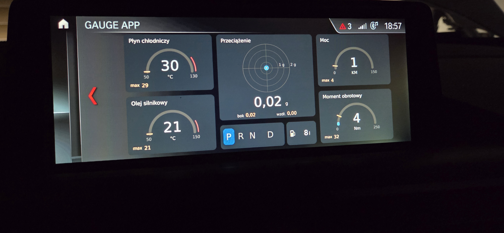
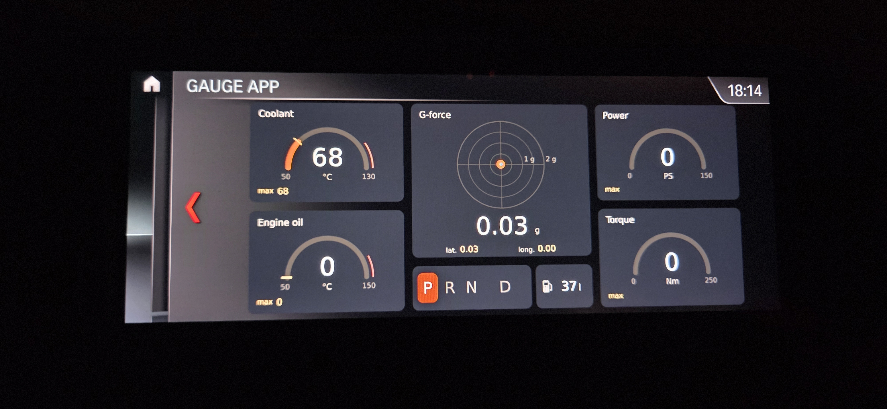

NBTEVO

EntryNav2



# IDRIVE GAUGE APP – ekran silnika w stylu iDrive 7

Natywna aplikacja iDrive dla **NBT Evo** (ID5/ID6, QNX) i **EntryNav2** (EntryEVO, Linux). Jeden ekran w układzie
2-1-2:

- po lewej **temperatura płynu chłodniczego** i **oleju**,
- w środku **przeciążenie** (kropka na tarczy do 2 g, wartość całkowita, boczna i wzdłużna) i **bieg** (P R N D, przy
  D aktualny bieg skrzyni: D1, D2…),
- po prawej **moc** (KM) i **moment obrotowy** (Nm).

Przy płynie, oleju, mocy i momencie jest **maksimum bieżącego przejazdu** (żółty znacznik na łuku i liczba „max”).
Maksima liczą się od zera przy każdym starcie aplikacji; te z ostatniego przejazdu zostają w `max.txt`. Skala mocy
i momentu rośnie razem z maksimum.

**Limit ok. 60 obrazków w jednym stanie** (sprawdzone w aucie: obrazki od ok. 60. w górę zostają puste). Dlatego tylko
duże wartości są składane z cyfr (3 elementy), a pozostałe liczby (maksima, końce skal, paliwo, przeciążenie) są
gotowymi obrazkami całych liczb – jeden element na liczbę. Ekran ma 47 obrazków.
Obok biegów jest **ilość paliwa** w zbiorniku (`sensors.fuel`, `tanklevel`).

**Język** dopasowuje się do języka iDrive. Teksty menu i ustawień są w bazie tekstów (`pl.txt` po polsku, pozostałe
języki po angielsku), którą iDrive wybiera sam. Napisy na samym ekranie (tytuły kart, „bok/wzdł.”, „KM”) są
w obrazkach, więc aplikacja wybiera je według `vehicle.language` z CDS: 18 = polski, każdy inny język = angielski
(„Coolant”, „lat./long.”, „PS”). Dopóki język nie przyjdzie, ekran jest po polsku. Liczby dziesiętne mają zawsze
**przecinek**, także po angielsku: osobne zestawy z kropką zajmowały ok. 2,4 MB.
Podgląd angielski: [`res/preview_en.png`](res/preview_en.png).

**Ustawienia** (klawisz OPTION na ekranie GAUGE APP → Ustawienia; zapis w `<folder danych>/settings.txt`):
kolor wskaźników (niebieski, czerwony, pomarańczowy BMW, zielony), temperatura (°C / °F), moc (KM / kW / hp),
moment (Nm / lb-ft), paliwo (litry / galony US). Wartości i maksima są trzymane w jednostkach bazowych, przeliczane
jest tylko to, co widać. Klatki w kolorze wskaźników (łuki, kropka przeciążenia, podświetlony bieg) są w osobnej
paczce dla każdego koloru (`GaugeApp_frames_c0..3.bin`); aplikacja wczytuje tylko wybraną.

Wygląd z przykładowymi wartościami (wygenerowany przez `make_db.py`): [`res/preview.png`](res/preview.png).

Aplikacja pojawia się jako wiersz **GAUGE APP** w menu **ConnectedDrive** (`applicationType="OnlineServices"`,
sprawdzone na EntryNav2; samo `"Online"` nie działa). `python3 make_db.py --menu media` przenosi ją do menu Media/Radio (`applicationType="Custom"`, po
wierszu Bluetooth audio, tam gdzie NbtAad i entry-aad umieszczają „Android Auto”). Identyfikatory różnią się od
nich, więc obie aplikacje mogą być zainstalowane razem.

**Biegi:** w D auto wysyła w `driving.gear` bieg skrzyni + 4 (sprawdzone na EntryNav2 F40: 5 = D1). 4 to samo „D”.

**Wiedza o jednostce EntryNav2** (system, framework aplikacji, pełna lista CDS z formatami i wynikami skanu):
[docs/EntryNav2](docs/EntryNav2/README.md).

### Więcej ekranów (OPTION)

Ekran wybiera się w Ustawieniach, tak jak kolor wskaźników: klawisz OPTION na dowolnym ekranie → Ustawienia, na
górze listy są ekrany (Silnik, Jazda, Spalanie i trasa, Pomiary, Rozgrzewanie), pod kreską ustawienia. Menu OPTION
ma tylko jedną pozycję aplikacji, „Ustawienia”; pozycje nad nią (np. „Wyłącz pojazd”) dodaje iDrive. Aplikacja
pamięta ostatni wyświetlany ekran (`screen=` w `settings.txt`, także po restarcie): przycisk GAUGE APP w menu otwiera
właśnie jego (przycisk wejścia to `raAction`, aplikacja wywołuje `focusEvent` 90 + numer ekranu, jak entry-aad
otwiera swoje menu). Każdy ekran to osobny stan HMI z własnym limitem ok. 60 obrazków:

| Ekran | Co pokazuje | Dane CDS |
|---|---|---|
| **Silnik** (stan 10) | jak wyżej | |
| **Jazda** (stan 14), [podgląd](res/preview_driving.png) | gaz i hamulec (paski), przeciążenie z maksimami w 4 kierunkach, kierownica i kąt, obciążenie silnika w %, bieg, podpowiedź zmiany biegu | `acceleratorPedal`, `brakeContact`, `steeringWheel`, `acceleration`, `torque` + `RPMSpeed`, `gear`, `shiftIndicator` |
| **Spalanie i trasa** (stan 15), [podgląd](res/preview_fuel.png) | spalanie chwilowe (l/100 km i l/h), wykres ostatnich 5 min, średnia tej trasy, średnie z komputera, zasięg, bak, km i czas od startu, zużyte paliwo, styl jazdy | `engine.consumption`, `speedActual`, `averageConsumption`, `averageSpeed`, `sensors.fuel`, `drivingStyle` |
| **Pomiary** (stan 16), [podgląd](res/preview_performance.png) | 0–100 (ostatni i najlepszy), 60–100, 80–120, 100–0 (m), 1/4 mili, stan, max przeciążenie boczne i hamowania | `speedActual`, `acceleration` |
| **Rozgrzewanie** (stan 17), [podgląd](res/preview_warmup.png) | olej i płyn na łukach od 0 °C (olej z celem 80 °C i zieloną strefą), stan, pasek postępu, czas pracy silnika, szacowany czas do rozgrzania, temperatura na zewnątrz, wewnątrz i parownika klimatyzacji, akumulator w % | `engine.temperature`, `engine.status`, `RPMSpeed`, `temperatureExterior`, `temperatureInterior`, `ACSystemTemperatures`, `sensors.battery` |

- **Obciążenie silnika** = moment / największy moment widziany przy tych obrotach. Krzywa uczy się w czasie jazdy
  i zostaje w `<folder danych>/torque-env.txt`. Dopóki przy danych obrotach nie ma co najmniej 60 Nm, karta pokazuje
  „--”. To zamiennik wskaźnika doładowania: CDS nie podaje ciśnienia doładowania.
- **Spalanie chwilowe** liczy się z licznika `engine.consumption`. Ten licznik tylko rośnie i przekręca się przy 65536.
  Jego jednostka nie jest opisana; na start przyjęte jest 1 µl na krok. Prawdziwy współczynnik aplikacja ustala sama
  z ubytku paliwa w baku: po każdych 8 l bez tankowania, zapis w `<folder danych>/fuel-cal.txt`, w logu „fuel counter
  calibrated”. Do pierwszej kalibracji spalanie chwilowe i zużyte paliwo mogą się różnić od komputera pokładowego.
- **Pomiary** korzystają z `driving.speedActual`, czyli całych km/h. Momenty przekroczenia progu są interpolowane
  między odczytami. 0–100 i 1/4 mili startują od ostatniego odczytu na postoju („Gotowy – ruszaj”), a 60–100 i 80–120
  mierzą się same przy każdym przyspieszaniu. Dokładność zależy od tego, jak często auto wysyła prędkość.
- **Odświeżanie tylko widocznego ekranu:** aplikacja czyta tytuł stanu na ekranie (`hmi.graphicalContext`,
  `menuTitle`, `appType`) i wysyła obrazki tylko do niego. Gdy na ekranie jest coś innego (radio, menu, ustawienia),
  nie wysyła nic. Wszystkie ekrany odświeża tylko wtedy, gdy tytuł jeszcze nie przyszedł albo gdy widać stan jakiejś
  wtyczki (`appType` „4”) z nieznanym tytułem. W logu: linie `on screen: '…'`.
- **Paczki klatek są mapowane (`mmap`), a nie wczytywane do pamięci.** System ładuje tylko strony z wysyłanymi
  klatkami i może je zwolnić, gdy brakuje pamięci. Paczka ekranów 1–4 (`GaugeApp_frames_s.bin`) jest mapowana
  dopiero przy pierwszym rysowaniu któregoś z nich; kto używa tylko ekranu Silnik, w ogóle jej nie otwiera.
- **Olej 0 °C w pierwszym odczycie po starcie** (`{"engine":68,"oil":0}`, czujnik jeszcze nieodczytany) jest
  traktowany jak brak danych, gdy płyn ma ponad 30 °C.
- **Rozgrzewanie:** silnik pracuje, gdy `engine.status` = 2 (albo obroty > 400, jeśli auto nie wysyła stanu). Silnik
  jest rozgrzany, gdy olej osiągnie 80 °C (`kWarmOilTarget`, typowa zasada dla silników BMW). Pasek postępu liczy się
  od temperatury oleju przy starcie. Czas do rozgrzania jest szacowany z tempa wzrostu temperatury oleju w ostatnich
  1–5 minutach, więc przez pierwszą minutę pokazuje „--”. Temperatury idą za ustawieniem °C / °F.
- Nowe ekrany pokazują paliwo w litrach, niezależnie od ustawienia jednostki paliwa.
- Wszystkie klatki są zapisane jako PNG z paletą (32 kolory dla napisów i liczb, 256 dla reszty), bo są 4–6 razy
  mniejsze niż RGBA; sprawdzone w aucie. Paczka ma ok. 12 MB: `GaugeApp_frames.bin` ok. 1,4 MB, każda paczka
  koloru ok. 1 MB, `GaugeApp_frames_s.bin` ok. 6 MB.
- Na ekranie Rozgrzewanie temperatury i akumulator są na środku kafelków.

## Jak to działa

HmiMain3D przy starcie ładuje `Plugins/GaugeApp/GaugeApp.manifest` (framework `PluginApp`, ten sam co w BMW
SecurityMenu / ActiveSeating, NbtAad i entry-aad). iDrive nie pozwala aplikacji rysować, więc cały ekran składa się
z obrazków:

- `GaugeApp.xml` opisuje obrazek tła (karty, podpisy, skale, tarcza) i 55 obrazków nad nim. Każdy z nich ma swoją
  pozycję w pikselach i model `raImageModel`, czyli obrazek, który aplikacja wysyła jako dane PNG.
- `GaugeApp_frames.bin` zawiera wszystkie klatki: łuki (61 kroków), znaczniki maksimum, cyfry w dwóch rozmiarach,
  kropkę przeciążenia (siatka 21×21, co 0,2 g) i pola biegów. Baza obrazków iDrive (`GaugeApp_ALL_Images.zip`) ma
  tylko ikonę wiersza menu.
- `libGaugeApp.so`:
  1. przy starcie wczytuje `GaugeApp_frames.bin`;
  2. po ok. 1,5 s subskrybuje właściwości **CDS** (Car Data Service) tym samym wywołaniem, którym NbtAad i entry-aad
     czytają `driving.gear`;
  3. co 200 ms wybiera klatkę dla każdego obrazka (`src/gauge_view.hpp`) i przez
     `PluginApp::updateModel(model, bmw::Image)` wysyła **tylko te, które się zmieniły**;
  4. wartość niedostępna, błędna albo nierealna (np. `{"error":400}`) pokazuje `--`.

Dlaczego tak, a nie przez bazę obrazków iDrive – diagnostyka na EntryNav2 (F40) pokazała, że:
- z 635 klatkami w bazie iDrive nie pokazuje **żadnego** obrazka (i zgłasza `onError 9`), a z kilkoma – wszystkie;
- obrazki wysyłane przez aplikację jako dane działają, zachowują pozycję x/y, nakładają się i można je wymieniać ok. 5
  razy na sekundę;
- widoczny obszar ekranu aplikacji to ok. 1250 × 470 px. Układ 960×400 jest skalowany ×1,15 do 1104×460 i
  wyśrodkowany (`SCALE`, `ORIGIN` w `make_db.py`).

| Właściwość CDS | Przykładowa wartość | Na ekranie |
|---|---|---|
| `engine.temperature` | `{"temperature":{"engine":19,"oil":18}}` | Płyn (50–130 °C), olej (50–150 °C) |
| `engine.torque` | `{"torque":380}` (Nm) | Moment |
| `engine.RPMSpeed` | `{"RPMSpeed":3600}` | tylko do mocy: KM = Nm × obr/min / 7023,5 |
| `driving.acceleration` | `{"acceleration":{"lateral":-0.19,"longitudinal":65535.00}}` | Przeciążenie (m/s² ÷ 9,81) |
| `driving.speedActual` | `{"speedActual":87}` | przeciążenie wzdłużne, gdy auto nie podaje `longitudinal` |
| `driving.gear` | `{"gear":6}` | Bieg (1 N, 2 R, 3 P, 4+ D1…) |

Nazwy i formaty: <https://bimmergestalt.github.io/BMWConnectedAnalysis/cds/> (lista społeczności; część jednostek
jest tam oznaczona jako „prawdopodobnie”). W CDS nie ma mocy silnika, dlatego jest liczona z momentu i obrotów.

**Maksima** zerują się przy każdym starcie aplikacji. Maksima ostatniego przejazdu są w `<folder danych>/max.txt`
(NBT Evo: `/var/opt/gaugeapp`, EntryNav2: `/var/local/data/GaugeApp`), np. `coolant=98.0`, zapisywane najwyżej co 30 s
i przy zamknięciu aplikacji, przez plik tymczasowy i zmianę nazwy. Nowe maksimum musi przyjść w **dwóch odczytach
z rzędu** (liczy się mniejszy z nich), więc pojedynczy błędny odczyt nie zostaje rekordem.

**Skala mocy i momentu:** od 0 do maksimum + 5 %, zaokrąglonego w górę do 50. Najmniejszy koniec skali to 150 KM i
250 Nm. Skala tylko rośnie.

## Co jest sprawdzone, a co nie

**Sprawdzone (na komputerze):**
- Logika: parsowanie, moc, przeciążenie z prędkości, maksima z ochroną przed pojedynczym błędnym odczytem,
  zapis i odczyt `max.txt`, wybór każdej klatki (`tests/test_cds_values.cpp`).
- Cały cykl życia aplikacji na atrapie frameworka, w obu wersjach: `pluginAppInfo`, `onInit`, subskrypcja 6
  właściwości, przełączanie tylko zmienionych obrazków, błędne dane, zapis maksimów w `onFinalize` i ich odczyt przy
  kolejnym `onInit` (`tests/app_host_test.cpp`). `make check`.
- Wszystkie funkcje `bmw::…`, których biblioteka używa, są eksportowane przez biblioteki EntryNav2 z auta (`nm -D`
  na `lib/Entry_Evo_libs`, identycznych z plikami zgranymi z jednostki), w tym `Image(unsigned char const*, unsigned)`
  i `updateModel(unsigned, Image const&)`. Budowa obiektu `bmw::Image` (28 bajtów: nazwa pliku i bufor) jest odczytana
  z kodu maszynowego `libCoreFramework`.
- Wersja EntryNav2 kompiluje się na ARM (hard-float, NEON) i wymaga tylko `GLIBC_2.4`.

**Sprawdzone w aucie (EntryNav2, F40):** ładowanie aplikacji, wiersz w menu, stany i przejścia, etykiety, obrazki
wysyłane jako dane z pozycjami i nakładaniem, odświeżanie ok. 5 klatek/s, dane CDS: `engine.temperature`,
`engine.RPMSpeed`, `engine.torque`, `driving.gear`, `driving.acceleration` (z osią wzdłużną; 65535 tylko w pierwszym
odczycie), `driving.speedActual`; zapis maksimów.

**Niesprawdzone – do potwierdzenia w aucie:**
- **Cały docelowy ekran** (56 obrazków wysyłanych jako dane) – poszczególne elementy działają w diagnostyce, całość
  jeszcze nie była uruchomiona.
- **Wersja NBT Evo:** kompilacja `qcc` (nie ma tu QNX SDP 6.5) i to, czy budowa `bmw::Image` jest taka sama jak na
  EntryNav2.
- **Znak przyspieszenia** (`kLatSign`, `kLonSign` w `src/cds_values.hpp`) i znaczenie `engine.temperature.engine`
  (porównaj z zegarem). Surowe wartości trafiają do logu.

> Ingerencja w head unit odbywa się na Twoją odpowiedzialność. Aplikacja niczego nie patchuje i zapisuje tylko we
> własnym folderze danych.

## Wymagania

- **NBT Evo:** dostęp root/SSH i jedno z kodowań **A4A, A4A_REMOTE_APPS, REMOTE_HMI, TOUCH_COMMAND** (bez tego
  HmiMain3D nie ładuje PluginApps), jak w NbtAad.
- **EntryNav2:** dostęp root przez SSH (kabel ENET), jak w entry-aad.

## Budowanie

Wygenerowane pliki (`GaugeApp.xml`, `src/gauge_ids.hpp`, oba zipy, `res/preview.png`) są w repozytorium, więc do samej
kompilacji Pillow nie jest potrzebny. Po zmianie wyglądu:

```
python3 make_db.py              # Pillow + font DejaVu Sans (--font plik.ttf, --x / --y: przesunięcie ekranu)
python3 make_db.py --screen 800x480   # ekran 6,5" 800x480: osobny układ 760x446 z większymi napisami
make check                      # testy hostowe obu wersji (zwykły g++)
```

### Biblioteki BMW (`lib/`)

Do zbudowania biblioteki potrzebne są dwa pliki frameworka iDrive: `libAppFramework.A.so` i `libCoreFramework.A.so`.
To pliki BMW, więc **nie ma ich w repozytorium** (`lib/` jest w `.gitignore`). Trzeba je skopiować z jednostki tego
samego typu, najlepiej z auta, do którego budujesz (ta sama wersja oprogramowania). Są potrzebne tylko do linkowania;
do auta trafia wyłącznie `libGaugeApp.so`.

| Jednostka | Ścieżka w jednostce | Folder w projekcie | Rozmiary (F40 / NBT Evo ID5) |
|---|---|---|---|
| EntryNav2 | `/opt/hmi/lib/` | `lib\Entry_Evo_libs\` | ok. 40 KB / 72 KB |
| NBT Evo | `/opt/hmi/ID5/lib/` (na `hu-omap`) | `lib\NBT_evo_libs\` | ok. 52 KB / 95 KB |

**EntryNav2 przez SSH** (to samo połączenie co przy instalacji), w PowerShellu, w folderze projektu:

```powershell
New-Item -ItemType Directory -Force lib\Entry_Evo_libs
scp root@169.254.1.0:/opt/hmi/lib/libAppFramework.A.so root@169.254.1.0:/opt/hmi/lib/libCoreFramework.A.so lib\Entry_Evo_libs\
```

Albo przez pendrive, na jednostce: `cp /opt/hmi/lib/libAppFramework.A.so /opt/hmi/lib/libCoreFramework.A.so
/media/<pendrive>/` i `sync`.

**NBT Evo** nie ma `scp`. Przez pendrive, na jednostce (logowanie jak w
[docs/NbtEvo_Installation.md](docs/NbtEvo_Installation.md), potem `on -f /net/hu-omap/ /bin/sh`):

```sh
cp /opt/hmi/ID5/lib/libAppFramework.A.so /opt/hmi/ID5/lib/libCoreFramework.A.so /fs/usb0/
```

Albo przez SSH z komputera (Git Bash / WSL, w folderze projektu; `root@CAR` i opcje SSH jak w instrukcji NBT):

```sh
mkdir -p lib/NBT_evo_libs
for f in libAppFramework.A.so libCoreFramework.A.so; do
  ssh root@CAR "cat /net/hu-omap/opt/hmi/ID5/lib/$f" > lib/NBT_evo_libs/$f
done
```

Sprawdzenie: oba pliki mają rozmiar podobny do tabeli wyżej (nie 0 bajtów). `make` i `build_entryNav2.bat` same
przerywają z komunikatem, jeśli plików brakuje. Pliki z innej wersji oprogramowania zwykle też działają (te same
eksportowane funkcje `bmw::PluginApp`), ale zbudowana biblioteka jest sprawdzona tylko z plikami z F40 (EntryNav2).

**NBT Evo:** QNX SDP 6.5.0 (`qcc`; instaluje się razem z QNX Momentics IDE 4.7) i kopie bibliotek BMW z
`/opt/hmi/ID5/lib` w `lib/NBT_evo_libs`.

- **Windows:** `build_nbt.bat` (albo `build_nbt.bat D:\QNX650`, jeśli QNX nie jest w `C:\QNX650`). Skrypt sam wywoła
  `qnx650-env.bat`, skompiluje bibliotekę i złoży w `dist\nbt\GaugeApp` wszystko, co trzeba skopiować na jednostkę.
- **Linux / obraz qnx650-docker:** `make` (`libGaugeApp.so`).
- **Momentics IDE** (jeśli wolisz projekt): *File → New → QNX C/C++ Project*, typ *Shared Library*, wariant
  **armle-v7** (so), biblioteka C++ **GNU libstdc++** (nie Dinkum – tak jak HmiMain3D); źródła `src/*.cpp`
  (`engine_data`, `cds`, `render`, `frames`, `storage`, `log`), ścieżka nagłówków `src`, definicja `_QNX_SOURCE`,
  opcja `-fvisibility=hidden`, do linkowania `libAppFramework.A.so` i `libCoreFramework.A.so`
  z `lib/NBT_evo_libs` oraz opcja linkera `--allow-shlib-undefined`; nazwa wyniku `libGaugeApp.so`.

Kod jest w C++98 (GCC 4.4.2 z SDP 6.5); na komputerze kompiluje się `g++ -std=gnu++98` bez ostrzeżeń, ale `qcc`
nie był tu uruchomiony. Wszystkie funkcje BMW, których używa, są w bibliotekach z `lib/NBT_evo_libs` (`nm -D`),
a obiekt `bmw::Image` ma na NBT tę samą budowę co na EntryNav2 (sprawdzone w kodzie maszynowym).

**EntryNav2:** kopie `libAppFramework.A.so` i `libCoreFramework.A.so` z `/opt/hmi/lib` w `lib/Entry_Evo_libs` i
obraz Dockera z `toolchain/Dockerfile` (Ubuntu 12.04: armhf GCC 4.6 i eglibc 2.15, ta sama wersja co w aucie).
Nowszy kompilator podlinkowałby funkcje, których auto nie ma (np. `clock_gettime@GLIBC_2.17`).

**Windows:** `build_entryNav2.bat` robi wszystko sam: w razie potrzeby uruchamia Docker Desktop, za pierwszym razem
buduje obraz kompilatora, buduje paczkę i sprawdza, że biblioteka wymaga tylko `GLIBC_2.4`.
`build_entryNav2.bat test` najpierw uruchamia testy w WSL (`make check`) i buduje paczkę tylko wtedy, gdy przejdą.

Ręcznie (Linux / WSL):

```
docker build -t gauge-entrynav2-tc toolchain        # raz
bash toolchain/tc-entrynav2.sh make entrynav2-dist
```

Wynik: `dist/gauge-app-entrynav2.tar` (biblioteka, manifest, XML, dwa zipy, paczki klatek, `MD5SUMS`).

## Instalacja

Pełne instrukcje krok po kroku (po polsku / po angielsku):

- **EntryNav2:** [docs/EntryEvo_Installation.md](docs/EntryEvo_Installation.md) /
  [docs/EntryEvo_Installation_EN.md](docs/EntryEvo_Installation_EN.md)
- **NBT Evo:** [docs/NbtEvo_Installation.md](docs/NbtEvo_Installation.md) /
  [docs/NbtEvo_Installation_EN.md](docs/NbtEvo_Installation_EN.md)

### NBT Evo

W skrócie – na `hu-omap` (`on -f /net/hu-omap/ /bin/sh`), pliki z `dist\nbt\GaugeApp` na pendrivie (`/fs/usb0`
albo `/mnt/umass…`):

```
/bin/mount -u -o rw /fs/sda0
mkdir -p /opt/hmi/ID5/data/ro/Plugins/GaugeApp
cp /fs/usb0/GaugeApp/* /opt/hmi/ID5/data/ro/Plugins/GaugeApp/
/bin/mount -u -o ro /fs/sda0
```

Potem przytrzymaj przycisk zasilania ok. 30 s (restart).

### EntryNav2

Przez SSH, kablem ENET, tak jak entry-aad (auto stoi, zapłon włączony, nie wyłączać w trakcie zapisu):

```
scp dist/gauge-app-entrynav2.tar root@169.254.1.0:/tmp/
ssh root@169.254.1.0
cd /tmp && mkdir -p gauge && tar -xf gauge-app-entrynav2.tar -C gauge && cd gauge && md5sum -c MD5SUMS
LD_TRACE_LOADED_OBJECTS=1 LD_WARN=yes LD_BIND_NOW=yes LD_LIBRARY_PATH=/usr/local/lib:/opt/hmi/lib:/usr/lib:/lib \
    /lib/ld-linux-armhf.so.3 ./opt/hmi/data/ro/Plugins/GaugeApp/libGaugeApp.so 2>&1 | grep -E 'not found|undefined symbol'
mount -o remount,rw /
mkdir -p /opt/hmi/data/ro/Plugins/GaugeApp
rm -f /opt/hmi/data/ro/Plugins/GaugeApp/*
cp opt/hmi/data/ro/Plugins/GaugeApp/* /opt/hmi/data/ro/Plugins/GaugeApp/
chmod 755 /opt/hmi/data/ro/Plugins/GaugeApp/libGaugeApp.so
sync
mount -o remount,ro /
cd / && md5sum -c /tmp/gauge/MD5SUMS && rm -rf /tmp/gauge /tmp/gauge-app-entrynav2.tar
reboot
```

- Polecenie z `LD_TRACE_LOADED_OBJECTS` nie może nic wypisać (każda linia = brakująca biblioteka lub funkcja).
- `/var/local/data` jest zamontowany z `noexec`, dlatego biblioteka musi leżeć na partycji systemowej.
- `rm -f` przed kopiowaniem: iDrive trzyma starą bibliotekę w pamięci do restartu.

W **ConnectedDrive** powinien pojawić się wiersz **GAUGE APP**.

### Obie wersje

| | NBT Evo | EntryNav2 |
|---|---|---|
| Folder aplikacji | `/opt/hmi/ID5/data/ro/Plugins/GaugeApp` | `/opt/hmi/data/ro/Plugins/GaugeApp` |
| Folder danych (maksima, wyłącznik) | `/var/opt/gaugeapp` | `/var/local/data/GaugeApp` |
| Log | `slog` (`sloginfo \| grep GaugeApp`) + pendrive | `gauge-app.log` w folderze danych (512 KB) + pendrive |
| Ochrona przed pętlą restartów | brak | 3 restarty HMI w < 2 min po załadowaniu → aplikacja się wyłącza |

- **Wyłączenie bez usuwania:** `touch <folder danych>/app.disable` i restart.
- **Po zadziałaniu ochrony (EntryNav2):** sprawdź log, potem `rm -f /var/local/data/GaugeApp/app-guard` i restart.
- **Odinstalowanie:** usuń folder aplikacji (i folder danych, jeśli maksima nie są potrzebne), restart.
- **Aktualizacja:** jak instalacja; `max.txt` zostaje.

## Diagnostyka

**Log na pendrivie:** utwórz na komputerze pusty plik `gauge-app.log` na pendrivie i włóż go do auta – log będzie
dopisywany tam (limit 4 MB). NBT Evo szuka go w `/mnt/umass*`, EntryNav2 w każdym folderze pod `/media`, `/mnt` i
`/run/media`.

Każda właściwość CDS trafia do logu w surowej postaci przy pierwszych 5 odczytach, np.
`CDS driving.acceleration = '{"acceleration":{"lateral":-0.19,"longitudinal":65535.00}}' -> ok`. Z tego widać, co
Twoje auto naprawdę wysyła i czy jednostki się zgadzają.

**Brak danych (wszędzie `--`):** 25 s po starcie w logu pojawi się `no CDS value arrived…`. Auto nie publikuje tych
właściwości aplikacjom albo subskrypcja się nie powiodła – prześlij fragment logu.

**Ekran się rozsypał** (obrazki jeden pod drugim, ucięte, przesunięte): iDrive inaczej traktuje pozycje obrazków.
Prześlij zdjęcie ekranu; pozycję całości można przesunąć `make_db.py --x/--y`, a układ zmienić w `make_db.py`.

**Brak wiersza w menu:** sprawdź kodowanie (NBT Evo), obecność wszystkich 5 plików, konflikt `entryButtonFocusID` /
`<id>` w manifeście oraz log HMI.

## Dostosowanie

- **Wygląd, układ, kolory, napisy, zakresy płynu i oleju, najmniejsze końce skal:** stałe na górze `make_db.py`,
  potem `python3 make_db.py` i przebudowa.
- **Jednostka / znak przyspieszenia, przelicznik mocy:** stałe „tuning” w `src/cds_values.hpp`.
- **Częstotliwość odświeżania i zapisu maksimów:** `kRenderMs`, `kSaveEveryS` w `src/app.hpp`.

## Układ projektu

```
make_db.py                 układ ekranu -> GaugeApp.xml, src/gauge_ids.hpp, oba zipy, res/preview.png
src/cds_values.hpp         parsowanie CDS, moc, przeciążenie, maksima, język (czysta logika, testowana)
src/drive_stats.hpp        g w każdym kierunku, obciążenie, kalibracja spalania, trasa, pomiary (czysta logika)
src/gauge_view.hpp         ekran Silnik: która klatka w którym obrazku, ustawienia (czysta logika, testowana)
src/screens_view.hpp       ekrany 1..4 i ich tabela kScreenDescs (czysta logika, testowana)
src/gauge_ids.hpp          wygenerowane: identyfikatory obrazków, slotów i tytuły ekranów
src/compat.hpp             GA_STATIC_ASSERT, GA_COUNT (C++98)
src/bmw_framework.hpp      ręczne deklaracje frameworka BMW (nazwy symboli jak w bibliotekach aut)
src/app.hpp                wewnętrzny interfejs modułów: stałe, AppState, MutexLock, FrameSink
src/engine_data.cpp        PluginApp: punkt wejścia, vtable, onInit/onFinalize, przyciski, takt rysowania
src/cds.cpp                wartości CDS -> stan aplikacji (po jednym stubie na właściwość)
src/render.cpp             które obrazki się zmieniły -> tylko te wysyłane; co jest na ekranie
src/frames.cpp             paczki klatek (mmap), obrazki jako dane do raImageModel
src/storage.cpp            max.txt, settings.txt, pliki uczone, crash guard
src/log.cpp                log (plik, pendrive, slog), czas
GaugeApp.xml               wygenerowane: wiersz menu + ekran z obrazkami
GaugeApp.manifest          manifest dla CAppManager
toolchain/                 obraz Dockera i skrypt do budowy wersji EntryNav2
tests/                     testy hostowe, atrapa frameworka (obie wersje), check_abi.sh (importy vs biblioteki aut)
lib/NBT_evo_libs, lib/Entry_Evo_libs   kopie bibliotek BMW z aut (nie są częścią projektu)
```

## Licencja i pochodzenie

Wzorce ABI frameworka (konstruktor `PluginApp`, własna vtable, `Runnable`, `pluginAppInfo`) i sposób czytania CDS
pochodzą z NbtAad (<https://github.com/Sq00ky/Supra-iDrive6-Android-Auto>, PolyForm Noncommercial 1.0.0) i entry-aad,
więc ten projekt jest udostępniony na tej samej licencji: tylko do użytku niekomercyjnego. Biblioteki BMW
(`libAppFramework`, `libCoreFramework`) nie są częścią projektu.
